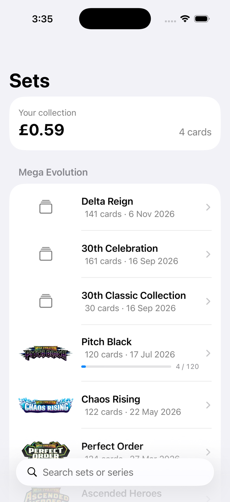
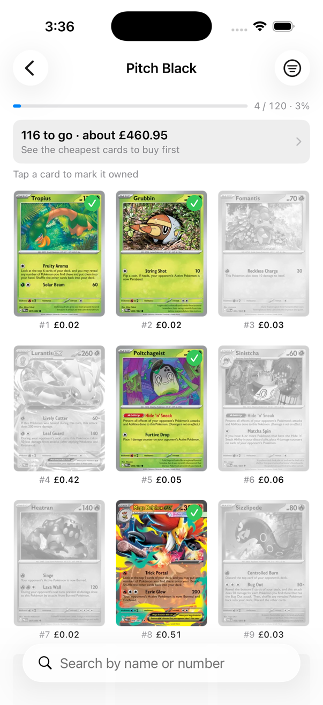
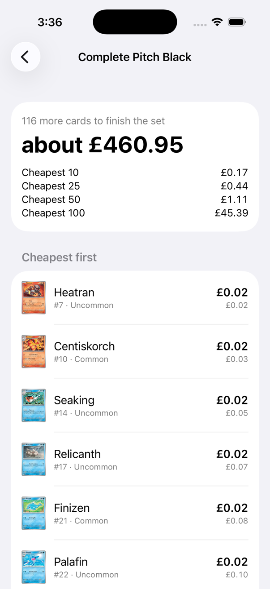
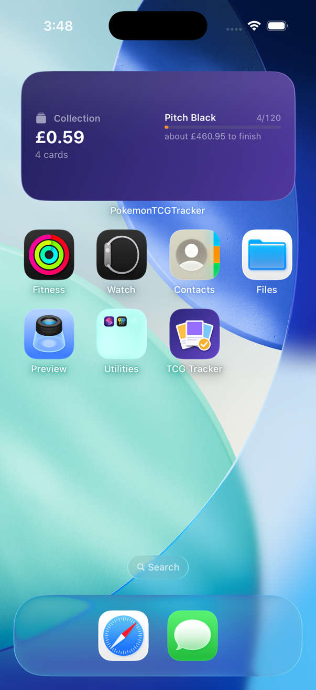

# TCG Tracker

An iPhone app for logging Pokémon cards that helps you complete sets as cheaply as possible.

Most collection apps log cards and show their value. This one focuses on finishing sets: it tells you what's left, what it costs, and which cards to buy first.

| Sets | Card grid | Cheapest path to completion | Home screen widget |
|---|---|---|---|
|  |  |  |  |

Project 3 of a three-part portfolio, alongside the [Competitive Meta Tracker](https://github.com/Eb-8734843/pokemon-meta-tracker) (Python) and the [Team Builder](https://github.com/Eb-8734843/pokemon-team-builder) (JavaScript).

## Features

- **Every set, newest first**, grouped by series, with logos and search.
- **Tap a card to mark it owned.** Owned cards show in colour with a tick; the rest are greyed out. An **Undo** bar covers accidental taps, including a run of them.
- **Progress bars** for each set you've started, and a percentage inside each set.
- **Search and filters** inside a set: by name or number, owned or missing, rarity, and type.
- **Prices in pounds** under every card, from Cardmarket.
- **Collection value** at the top of the set list.
- **Cheapest path to completion**: the cards you're missing, cheapest first, with a running total and what the cheapest 10, 25, 50 and 100 cost. For example, the last 20 cards of Pitch Black cost far more than the first 100.
- **Budget mode**: type what you want to spend, or tap £5, £10, £20 or £50, and it shows how many cards that buys, cheapest first, what's left over, and how much more the next card needs. A line in the list marks where the budget runs out. The budget is remembered between launches.
- **Home screen widget** (small and medium) with your collection's value and the sets you're closest to finishing.
- **Works offline**: set lists, card lists and prices are saved on the phone, so it works at a card shop with no signal.

## How it works

| Part | What it does |
|---|---|
| [`TCGdexClient`](PokemonTCGTracker/Networking/TCGdexClient.swift) | Gets sets (one GraphQL request) and cards (REST, 8 at a time) from [TCGdex](https://tcgdex.dev), a free card database with no API key. |
| [`DiskCache`](PokemonTCGTracker/Networking/DiskCache.swift) | Saves the last good set and card lists on the phone; screens show the saved copy first, then refresh. |
| [`OwnedCard`](PokemonTCGTracker/Models/OwnedCard.swift) | The SwiftData record of each card you own, with its last known price so the collection value works offline. |
| [`OwnershipEditor`](PokemonTCGTracker/Features/Shared/OwnershipEditor.swift) | Every tick and untick goes through here, so they can be undone. |
| [`CardFilter`](PokemonTCGTracker/Features/SetDetail/CardFilter.swift) | Search and filters for a set's cards. |
| [`CompletionPlan`](PokemonTCGTracker/Features/Completion/CompletionPlan.swift) | Works out the missing cards, cheapest first, their totals, and how many a budget buys. |
| [`ExchangeRates`](PokemonTCGTracker/Networking/ExchangeRates.swift) | Converts Cardmarket's euro prices to pounds with the European Central Bank's daily rate, from [Frankfurter](https://frankfurter.dev). |
| [`WidgetSnapshot`](Shared/WidgetSnapshot.swift) | A small summary the app writes to a shared App Group folder for the [widget](CollectionWidget/CollectionWidget.swift) to read. |

### Prices

Each card uses Cardmarket's **trend** price (what it's selling for now), falling back to the 30-day average, then the reverse-holo trend. The "low" price is ignored because it's usually one damaged or odd listing: for Mega Delphox ex in November 2026 the trend was €0.61 but the low was €0.05. Shop prices and postage will differ.

### Data source history

The app started on [pokemontcg.io](https://pokemontcg.io). In November 2026 that API failed 6 to 8 requests in 10 and no longer included prices, so the app moved to TCGdex. A one-time [migration](PokemonTCGTracker/Models/OwnedCardMigration.swift) moved owned cards to TCGdex's card numbers.

## Running it

1. Open `PokemonTCGTracker.xcodeproj` in Xcode 26 or later.
2. Choose an iPhone simulator and press **Run**. No API key or account is needed.
3. To try the widget: on the simulator's home screen, press and hold, tap **Edit → Add Widget**, and search for "TCG Tracker".

To run it on your own iPhone:

1. Sign in under **Xcode → Settings → Apple Accounts**. A free Apple ID works.
2. Under **Signing & Capabilities**, pick your team for both the app and the CollectionWidget target. If Xcode says the bundle ID or App Group is taken, change them to ones your account can register (the App Group ID also appears in [`WidgetSnapshot.swift`](Shared/WidgetSnapshot.swift) and the two `.entitlements` files).
3. Connect the phone, turn on **Developer Mode** (Settings → Privacy & Security), pick it as the run destination and press **Run**.
4. The first time, trust the developer on the phone under **Settings → General → VPN & Device Management**.

With a free Apple ID the app stops opening after 7 days; run it from Xcode again to renew it.

## Tests

32 unit tests (Swift Testing) cover reading TCGdex data, card sorting, search and filters, saving on the phone, the migration, prices, completion totals, budget mode, Undo and the widget summary.

```bash
xcodebuild test -project PokemonTCGTracker.xcodeproj -scheme PokemonTCGTracker -destination 'platform=iOS Simulator,name=iPhone 17 Pro' -only-testing:PokemonTCGTrackerTests
```

## Project layout

```
PokemonTCGTracker/       The app
  Features/              Screens: SetList, SetDetail, Completion, Shared
  Models/                Cards, sets, owned cards, migration, price refresh
  Networking/            TCGdex client, saving on the phone, exchange rates
CollectionWidget/        The home screen widget
Shared/                  Code used by both the app and the widget
PokemonTCGTrackerTests/  Unit tests
tools/make_icon.py       Draws the app icon (Python + Pillow)
```

## Credits

Card data and images from [TCGdex](https://tcgdex.dev). Prices from Cardmarket via TCGdex. Exchange rates from the European Central Bank via [Frankfurter](https://frankfurter.dev).

This is a personal portfolio project and isn't affiliated with or endorsed by Nintendo, The Pokémon Company, Creatures or GAME FREAK. Pokémon and card names are trademarks of their respective owners.
